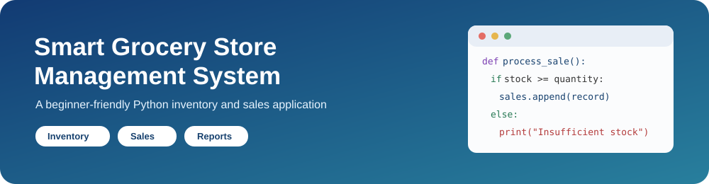
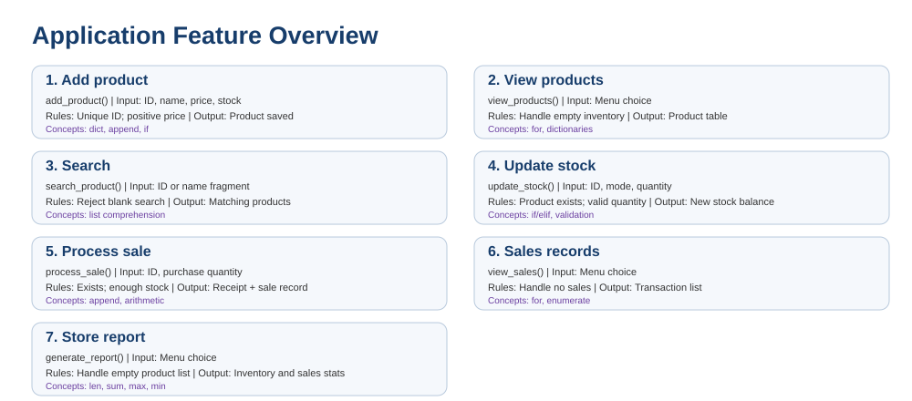
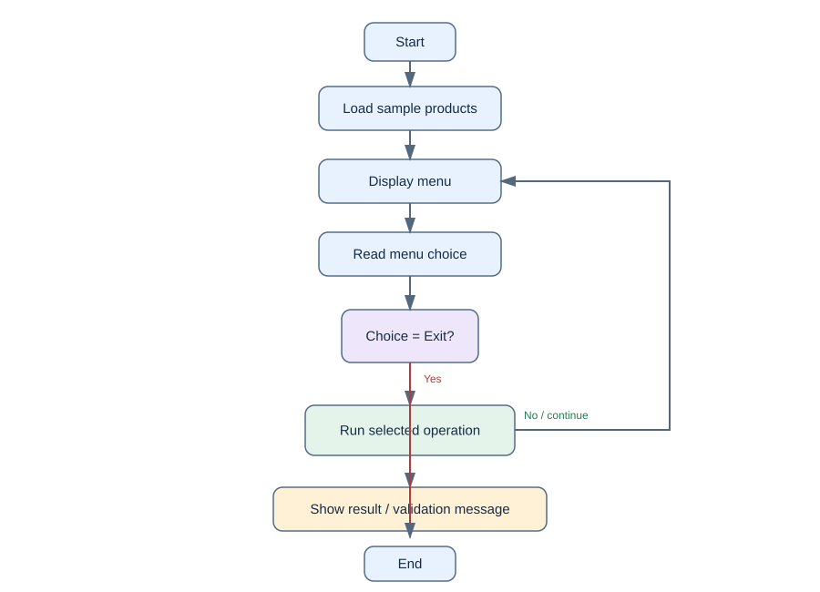
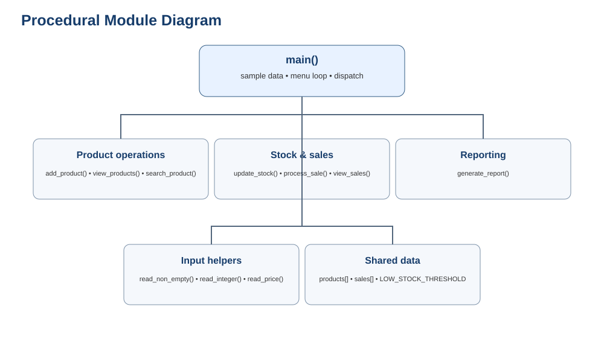

<p align="center"></p>

# Smart Grocery Store Management System

## 1. Project Overview

A beginner-friendly, menu-driven Python application for managing grocery products, inventory, customer sales, and a store summary report. It uses in-memory lists and dictionaries; data resets when the program exits.

| Task | File / function | Topic |
|---|---|---|
| Add products | `smart_grocery_store.py` / `add_product()` | Dictionaries, lists, validation |
| View products | `view_products()` | Loops and dictionary values |
| Search products | `search_product()` | String matching, list comprehension |
| Update stock | `update_stock()` | Conditions and numeric input |
| Process sales | `process_sale()` | Stock checks, calculations, records |
| View sales | `view_sales()` | Lists of dictionaries |
| Store report | `generate_report()` | `len`, `sum`, `max`, `min` |



## 2. Folder Structure

```text
smart-grocery-store-management/
├── smart_grocery_store.py
├── README.md
└── assets/
    ├── banner.svg
    ├── overview.svg
    ├── smart_grocery_store_flow.svg
    └── uml_diagram.svg
```

## 3. Application Operations

### Task 1 — Add New Product

**Summary:** Adds a product dictionary to the `products` list after checking its ID and details.

**Rules**
- Product IDs must be unique.
- Name cannot be blank.
- Price must be a valid number greater than zero.
- Stock must be a whole number of zero or more.

**Program Flow**



**Code Methods Description**

| Method / section | Purpose |
|---|---|
| `read_non_empty()` | Rejects blank text |
| `read_price()` | Validates a positive price |
| `read_integer()` | Validates whole-number stock |
| `find_product_by_id()` | Checks whether an ID already exists |
| `add_product()` | Appends the new product dictionary |

**Input Validation:** Duplicate IDs, blank names/IDs, non-numeric prices, zero/negative prices, and invalid or negative stock are rejected.

**Expected Results:** A valid product is stored and a success message is displayed. Invalid product details are not added.

### Task 2 — View All Products

**Summary:** Displays each product's ID, name, unit price, and available stock.

**Rules**
- Shows all products in the inventory.
- Displays a clear message when the inventory is empty.

**Program Flow:** The menu calls `view_products()`, which checks the list and loops through each product.

**Code Methods Description**

| Method / section | Purpose |
|---|---|
| `view_products()` | Prints the product table |

**Input Validation:** No additional input is required. An empty list is handled safely.

**Expected Results:** A formatted inventory table or `No products found.`

### Task 3 — Search Product

**Summary:** Finds a product using its exact ID or a partial, case-insensitive name.

**Rules**
- ID search is exact.
- Name search accepts a part or the full name.
- No match produces a clear message.

**Program Flow:** Read search text → compare ID/name → display matches or not-found message.

**Code Methods Description**

| Method / section | Purpose |
|---|---|
| `read_non_empty()` | Rejects an empty search |
| `search_product()` | Finds and displays matching records |

**Input Validation:** Blank search text is rejected.

**Expected Results:** One or more matching products, or `No matching product found.`

### Task 4 — Update Product Stock

**Summary:** Adds stock to an existing product or replaces its stock with a new quantity.

**Rules**
- Product ID must exist.
- Option 1 adds stock; option 2 sets stock.
- Added quantity must be at least 1.
- New stock quantity can be zero or greater.

**Program Flow:** Find product → select update mode → validate quantity → update stock.

**Code Methods Description**

| Method / section | Purpose |
|---|---|
| `find_product_by_id()` | Locates the selected product |
| `read_integer()` | Validates the quantity |
| `update_stock()` | Applies the selected stock change |

**Input Validation:** Unknown IDs, invalid menu choices, non-integer values, negative quantities, and zero added quantity are rejected.

**Expected Results:** The updated stock balance is displayed.

### Task 5 — Process Customer Sale

**Summary:** Processes a purchase only when the product exists and enough stock is available. A completed sale is appended to the separate `sales` list.

**Rules**
- Product must exist.
- Purchase quantity must be a positive whole number.
- Quantity cannot exceed available stock.
- Stock is reduced only after all checks pass.

**Program Flow:** Enter ID → find product → enter quantity → check available stock → calculate total → reduce stock → append sale record → print receipt.

**Code Methods Description**

| Method / section | Purpose |
|---|---|
| `find_product_by_id()` | Locates the product |
| `read_integer()` | Validates purchase quantity |
| `process_sale()` | Checks stock, calculates amount, updates inventory, and records sale |

**Input Validation:** Unknown product IDs, invalid numbers, zero/negative quantities, and insufficient stock are rejected. Failed sales do not change inventory or sales records.

**Expected Results:** A purchase summary with product, quantity, unit price, total amount, and remaining stock.

### Task 6 — View Sales Records

**Summary:** Displays all completed transactions from the separate `sales` list.

**Rules**
- Only successful sales are recorded.
- Each record includes product ID, name, quantity, unit price, and total.
- Empty sales history is handled.

**Program Flow:** Check sales list → display each transaction or an empty-history message.

**Code Methods Description**

| Method / section | Purpose |
|---|---|
| `view_sales()` | Loops through completed sales and prints transaction details |

**Input Validation:** No additional input is required.

**Expected Results:** A numbered transaction list or `No sales records found.`

### Task 7 — Generate Store Report

**Summary:** Calculates product count, total stock, number of sales, revenue, low-stock products, and highest/lowest-priced products.

**Rules**
- Low stock means 5 units or fewer.
- Revenue is the sum of completed sale totals.
- Highest/lowest price is calculated from current products.
- Empty inventory does not cause an error.

**Program Flow:** Calculate counts and sums → identify low-stock products → find price extremes when products exist → display report.

**Code Methods Description**

| Method / section | Purpose |
|---|---|
| `generate_report()` | Calculates and displays all report statistics |

**Input Validation:** No additional input is required. Empty products and sales lists are handled.

**Expected Results:** A complete store summary with safe messages when no products or sales exist.

## 4. UML Diagram

A **procedural module diagram** is used because the application is organized around functions and shared lists rather than user-defined classes. It shows the main function, operation groups, input helpers, and shared data.



## 5. Concepts and Techniques Used

- Lists of dictionaries for products and sales.
- Dictionary keys and values for product and transaction data.
- `.append()` to store products and completed sales.
- Reusable custom functions.
- `for` and `while` loops.
- `if`, `elif`, and `else` conditions.
- `try` / `except ValueError` for numeric input.
- `len()`, `sum()`, `max()`, and `min()` for reporting.
- List comprehension for low-stock products.
- Input validation and clear error messages.
- In-memory data storage.

## 6. How to Run

**Requirements:** Python 3.8 or newer. No external libraries are required.

Clone the repository:

```bash
git clone https://github.com/aliraza019013-droid/smart-grocery-store-management.git
cd smart-grocery-store-management
```

Run the application:

```bash
python smart_grocery_store.py
```

Alternative commands:

```bash
python3 smart_grocery_store.py
py smart_grocery_store.py
```

## 7. Sample Execution

The following outputs are from non-interactive test runs of the submitted program.

**Successful sale** (sample product Milk, ID `101`, quantity `2`):

```text
Purchase Summary
Product        : Milk
Quantity       : 2
Unit price     : Rs. 250.00
Total amount   : Rs. 500.00
Remaining stock: 18
Sale completed successfully.
```

**Duplicate product ID** (attempt to add ID `101`):

```text
Add New Product
Enter product ID: 101
Error: A product with this ID already exists.
```

**Insufficient stock** (Milk has 20 units; request 25):

```text
Enter product ID: 101
Enter purchase quantity: 25
Error: Insufficient stock. Available stock: 20
```

**Invalid numeric input** (enter `abc` for a stock quantity):

```text
Enter initial stock quantity: abc
Error: Please enter a valid whole number.
```

**Store report** (initial sample inventory, before any sale):

```text
Store Summary Report
Product count       : 3
Total stock units   : 45
Sales transactions  : 0
Total revenue       : Rs. 0.00
Low-stock threshold : 5 units
Low-stock products  : None
Highest-priced      : Rice (Rs. 300.00)
Lowest-priced       : Bread (Rs. 120.00)
```

## 8. Test Cases

The scenarios below were checked against the program's validation and calculation paths.

| # | Scenario | Inputs | Expected result |
|---:|---|---|---|
| 1 | Successful sale | ID `101`, quantity `2` | Sale total Rs. 500.00; Milk stock becomes 18 |
| 2 | Duplicate product | Add ID `101` | Duplicate ID rejected |
| 3 | Search by ID | `101` | Milk is displayed |
| 4 | Partial name search | `ri` | Rice is displayed |
| 5 | Add stock | ID `102`, option `1`, quantity `5` | Bread stock becomes 20 |
| 6 | Set stock | ID `103`, option `2`, quantity `0` | Rice stock becomes 0 |
| 7 | Insufficient stock | ID `101`, quantity `25` | Sale rejected; stock remains 20 |
| 8 | Unknown product sale | ID `999` | Product not found |
| 9 | Invalid numeric input | `abc` for quantity | Clear whole-number error; prompt repeats |
| 10 | Zero purchase quantity | ID `101`, quantity `0` | Rejected; prompt repeats |
| 11 | Empty search | Blank input | Blank-field error; prompt repeats |
| 12 | Report at initial state | No transactions | 3 products, 45 units, Rs. 0.00 revenue |

---

**Author:** Muhammad Ali Raza  
**GitHub:** [aliraza019013-droid](https://github.com/aliraza019013-droid/smart-grocery-store-management)

**Assignment note:** Product and sales data are stored in memory only. Restarting the program restores the three sample products and clears sales history.
